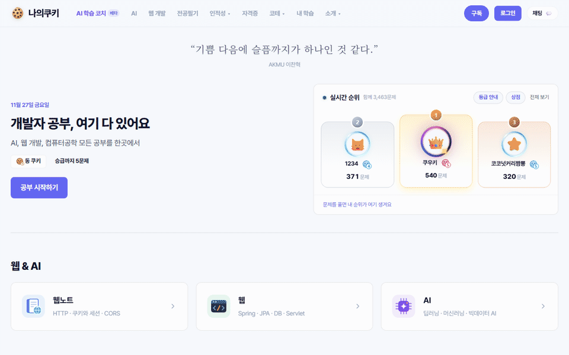

<h1 align="center">🍪 나의쿠키</h1>

  <b>개발자 취업 준비, 이제 쿠키 하나로.</b> 
  CS · 기술면접부터 코딩테스트, 실전 대결까지 무료로 공부하는 사이트

  <a href="https://mycookie.dev"><b>mycookie.dev 바로가기 →</b></a>

  

<b>한눈에 보기 (전체 소개 이미지)</b>

 

## 인프라

