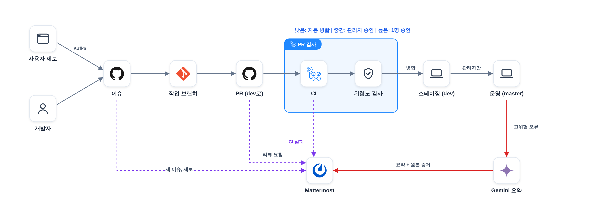
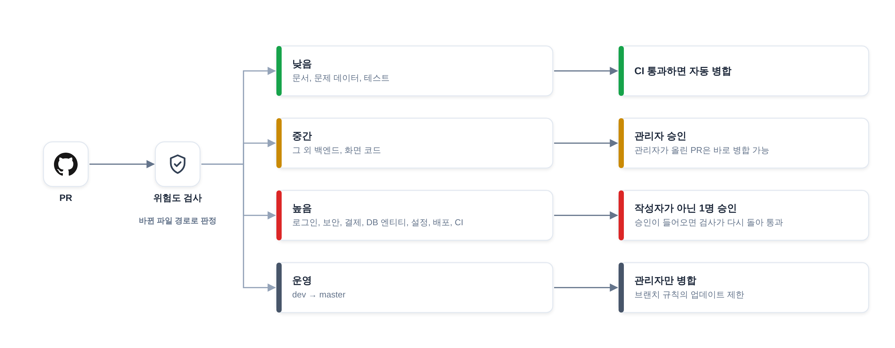
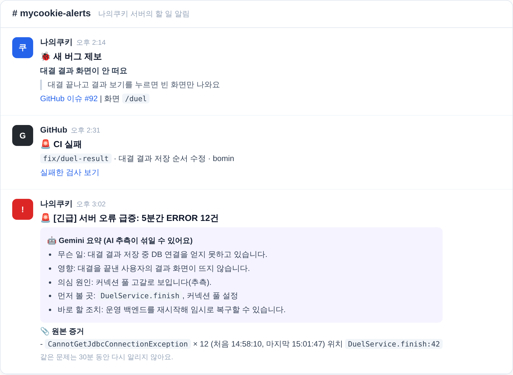
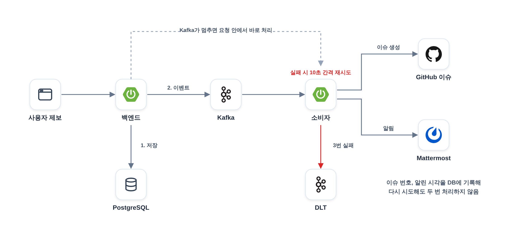
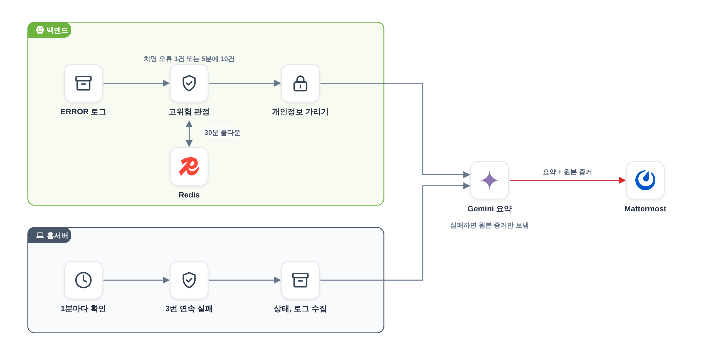

# 2인 개발팀의 워크플로 설계: PR 위험도 규칙부터 장애 알림까지

> 태그: 나의쿠키, CI, GitHub Actions, Kafka, 개발프로세스

나의쿠키는 개발자 취업 준비생을 위한 학습 사이트입니다. 지금까지는 혼자 개발하고 혼자 배포했습니다. 코드를 고치면 직접 확인했고, 운영에서 문제가 생기면 사용자가 알려 주거나 제가 우연히 발견할 때까지 몰랐습니다.

최근 팀원이 한 명 합류하면서 이 방식을 그대로 둘 수 없었습니다. 누가 무엇을 고쳤는지, 그 코드가 안전한지, 운영에서 문제가 생겼을 때 누가 언제 알게 되는지를 모두 한 사람의 기억에 맡기고 있었기 때문입니다.

이 글은 두 명이 운영하는 작은 서비스에 맞춰 개발 워크플로를 다시 설계한 기록입니다. CI 도입, 위험도에 따른 PR 병합 규칙, 이슈 관리, Mattermost 실시간 알림, 고위험 장애 알림까지 다룹니다.

## 무엇을 해결하려 했나

혼자 개발할 때는 문제가 되지 않던 습관들이 팀이 되자 위험 요소가 됐습니다.

| 문제 | 정한 것 |
| --- | --- |
| 테스트는 기억날 때만 돌린다 | 모든 PR에서 전체 테스트를 자동으로 돌린다 |
| 문서 수정과 DB 변경을 같은 무게로 병합한다 | 변경의 위험도에 따라 확인 절차를 다르게 한다 |
| 일감이 머릿속에만 있다 | 모든 일감을 GitHub 이슈로 남긴다 |
| 장애를 늦게 안다 | 고위험 오류는 채팅으로 바로 알린다 |

## 전체 흐름

*그림 1. 이슈 등록부터 운영 배포, 장애 알림까지의 흐름*

일은 이슈에서 시작합니다. 작업 브랜치에서 `dev`로 PR을 올리면 CI와 위험도 검사가 돌고, 조건을 채우면 병합됩니다. `dev`에 병합되면 스테이징에, `dev`에서 `master`로 병합되면 운영에 5분 안에 자동 배포됩니다. 이 과정에서 사람이 확인해야 하는 일만 Mattermost로 알립니다.

## CI: 사람이 빠뜨리는 것을 기계가 잡는다

GitHub Actions로 PR마다 두 작업을 돌립니다.

| 작업 | 내용 |
| --- | --- |
| 백엔드 테스트 | 전체 테스트. 스프링 컨텍스트가 실제로 뜨는지, Testcontainers로 PostgreSQL, Redis, Kafka를 띄운 통합 테스트까지 포함 |
| 화면 검사 | 린트, 빌드, 문제 데이터 검사 |

CI를 붙이는 과정에서 운영에 숨어 있던 버그를 찾았습니다. 실시간 대결은 서버가 정답표로 채점하는데, 최근 추가한 문제 27개가 정답표에서 빠져 있었습니다. 이 문제들이 대결에 나오면 서버가 채점을 하지 못하는 상태였습니다. 데이터 검사 스크립트는 예전부터 있었지만 아무도 돌리지 않았기 때문에 발견되지 않았습니다.

### 결과가 그때그때 다른 테스트

운영 중에 같은 커밋이 한 번은 통과하고 한 번은 실패하는 일이 있었습니다. 원인은 비동기 처리를 기다리지 않은 테스트였습니다.

제보가 들어오면 Kafka 소비자가 Mattermost 알림을 보내고, 그다음에 "알린 시각"을 DB에 저장합니다. 그런데 테스트는 알림이 호출된 것을 확인한 직후 DB를 읽었습니다. 소비자 스레드가 저장을 마치기 전에 읽으면 값이 비어 있어 실패했습니다. 저장이 끝날 때까지 기다리도록 테스트를 고쳐 해결했습니다.

이런 테스트를 "가끔 실패하는 테스트"로 두고 다시 돌리기만 하면, 팀은 점점 CI의 빨간 표시를 믿지 않게 됩니다. 그래서 실패하면 원인을 끝까지 찾는 것을 원칙으로 정했습니다.

## PR 위험도: 사람의 확인을 어디에 쓸 것인가

처음에는 모든 PR에 승인 한 명을 요구하려고 했습니다. 하지만 두 명이 일하는 팀에서 문서 오타 수정까지 서로의 승인을 기다리게 하면, 승인은 형식이 되고 작업만 느려집니다.

그래서 변경을 위험도로 나누고, 사람의 확인은 위험한 변경에만 쓰기로 했습니다. 위험도는 사람이 판단하지 않습니다. PR에서 바뀐 파일 경로를 보고 GitHub Actions가 자동으로 정합니다.

*그림 2. 바뀐 파일로 위험도를 정하고, 위험도마다 병합 조건이 다르다*

DB 엔티티를 높음으로 둔 데는 이유가 있습니다. 나의쿠키는 아직 JPA의 `ddl-auto: update`로 스키마를 관리합니다. 엔티티 필드 하나를 바꾸면 배포와 동시에 운영 DB의 테이블이 바뀝니다. 엔티티 코드 리뷰가 사실상 스키마 리뷰인 셈입니다.

위험도 검사는 PR의 필수 검사로 등록했습니다. 조건을 채우지 못하면 검사가 실패하고, GitHub의 브랜치 규칙(Rulesets)이 병합 버튼을 막습니다. 승인이 들어오면 검사가 다시 돌아 통과합니다. 판정 이유는 검사 요약에 남겨서 왜 막혔는지 PR 화면에서 바로 알 수 있게 했습니다.

### 자기 PR은 자기가 승인할 수 없다

운영 배포에는 관리자의 승인이 필요하다고 정했는데, 설계하면서 문제를 하나 발견했습니다. GitHub에서는 자신이 올린 PR을 스스로 승인할 수 없습니다. 관리자가 직접 `dev` → `master` PR을 올리면 승인할 사람이 없어 영원히 막힙니다.

그래서 "관리자의 승인"을 "관리자만 병합할 수 있음"으로 바꿨습니다. 브랜치 규칙에서 `master`의 업데이트 권한을 관리자에게만 열어 두면, 누구나 PR을 올릴 수 있지만 병합 버튼은 관리자만 누를 수 있습니다. 운영 배포가 항상 관리자의 손을 거친다는 목적은 그대로 지킬 수 있었습니다.

### 검토했지만 넣지 않은 것: AI 코드 리뷰

중간 위험도 PR을 AI가 리뷰하고 문제가 없으면 자동으로 병합하는 방식도 검토했습니다. 리뷰 부담을 줄일 수 있다는 장점이 있었지만, PR마다 유료 API 비용이 발생합니다. 개인이 운영하는 서비스에서 고정 비용이 계속 늘어나는 구조는 맞지 않다고 판단해 넣지 않았습니다. 작업 규칙에도 "유료 API를 쓰는 자동화는 넣지 않는다"고 적었습니다.

## 이슈 관리: Jira 대신 GitHub 이슈

일감 관리 도구로 Jira도 고민했습니다. 하지만 두 명이 일하는 팀에서는 도구가 하나 늘어나는 비용이 더 크다고 봤습니다. 코드, PR, CI가 모두 GitHub에 있으니 이슈도 같은 곳에 두는 편이 낫습니다. PR 본문에 `closes #12`를 적으면 병합할 때 이슈가 자동으로 닫히는 것처럼, 한곳에 있어서 얻는 이점이 컸습니다.

- 이슈는 "기능", "버그" 양식으로 등록하고, 제목 머리말과 라벨이 자동으로 붙습니다.
- 새 PR과 이슈의 담당자는 관리자로 자동 지정됩니다. 담당자가 비어 있는 이슈가 생기지 않게 하기 위해서입니다.
- 사용자가 사이트에서 보낸 버그 제보도 GitHub 이슈로 자동 등록됩니다. 사용자 제보와 내부 일감을 한곳에서 봅니다.

## 실시간 알림: 할 일이 생기는 것만

알림 채널은 팀이 매일 쓰는 SSAFY Mattermost에 만들었습니다. 다만 일반 사용자가 웹훅을 만들 수 있는지 확실하지 않아서, 본격적으로 만들기 전에 작은 검증(PoC)부터 했습니다. 팀 메뉴에는 "통합" 항목이 보이지 않았지만, 통합 페이지 주소로 직접 들어가니 수신 웹훅을 만들 수 있었습니다.

연결한 뒤 처음 한 시간 동안은 PR을 병합할 때마다, 이슈를 닫을 때마다 알림이 왔고 채널이 금방 시끄러워졌습니다. 그래서 기준을 하나로 정했습니다. **알림을 받은 사람이 지금 무언가 해야 하는가.**

| 알림 | 할 일 | 결정 |
| --- | --- | --- |
| 사용자 버그 제보, 기능 요청 | 확인하고 담당자 정하기 | 보냄 |
| 새 이슈 | 작업 시작 | 보냄 |
| PR 열림 | 리뷰 | 보냄 |
| CI 실패 | 바로 수정 | 보냄 |
| PR 병합, 이슈 닫힘 | 없음 | 보내지 않음 |

*그림 3. 알림 채널 예시. 사용자 제보, CI 실패, 고위험 장애 알림*

병합이나 닫힘 기록은 GitHub에 남습니다. 알림 채널에 할 일만 남기니 CI 실패처럼 중요한 알림이 다른 알림에 묻히지 않게 됐습니다.

### 제보 처리는 Kafka 이벤트로

사용자가 제보를 보내면 서버는 GitHub 이슈를 만들고 Mattermost로 알려야 합니다. 처음에는 이 작업을 요청 안에서 바로 처리했습니다. 그러면 GitHub이나 Mattermost가 느릴 때 사용자의 제보 요청도 같이 느려지고, 중간에 실패하면 다시 처리할 방법이 없었습니다.

*그림 4. 제보를 저장한 뒤 이벤트만 넣고 바로 응답한다. 이슈 생성과 알림은 소비자가 맡는다*

지금은 제보를 저장한 뒤 Kafka에 이벤트만 넣고 바로 응답합니다. 처리 중 실패하면 10초 간격으로 세 번 다시 시도하고, 그래도 실패하면 실패 전용 토픽(DLT)에 남깁니다.

다시 시도할 때 같은 이슈가 두 번 만들어지면 안 되므로 단계마다 결과를 DB에 기록했습니다. 이슈 번호가 이미 있으면 이슈 생성을 건너뛰고, 알린 시각이 이미 있으면 알림을 건너뜁니다. 테스트에서 첫 알림을 일부러 실패시켰을 때, 알림은 다시 시도해 성공했고 이슈는 한 번만 만들어졌습니다.

Kafka가 멈춰도 제보 기능은 멈추지 않습니다. 이벤트를 넣지 못하면 예전처럼 요청 안에서 바로 처리합니다. 서버 한 대에서 여러 서비스를 함께 돌리기 때문에 Kafka의 메모리를 작게 제한했고, 그만큼 Kafka가 불안정해질 수 있다는 전제로 이 우회로를 만들었습니다.

## 고위험 장애 알림: 정말 급한 것만, 바로 대응할 수 있게

마지막으로 사이트가 멈추거나 오류가 몰릴 때 바로 알 수 있게 만들었습니다. 모든 오류를 알리면 다시 채널이 시끄러워지므로 대상은 세 가지로 좁혔습니다.

| 상황 | 기준 | 감지 |
| --- | --- | --- |
| 치명 오류 | 메모리 부족, DB 연결 실패처럼 서비스 전체를 멈출 수 있는 오류는 한 번만 나도 | 백엔드 |
| 오류 급증 | 5분 동안 ERROR 로그 10건 이상 | 백엔드 |
| 사이트 다운 | 1분마다 확인해 3번 연속 응답이 없을 때 | 홈서버의 점검 스크립트 |

*그림 5. 백엔드는 오류를 모아 판정하고, 서버가 통째로 죽는 경우는 홈서버가 바깥에서 확인한다*

사이트가 통째로 죽으면 백엔드는 스스로 알릴 수 없습니다. 그래서 사이트 다운은 홈서버의 systemd 타이머가 바깥에서 확인합니다. 배포 중에는 백엔드가 잠깐 내려가므로 확인을 건너뛰고, 되살아나면 복구 알림을 한 번 보냅니다.

### 요약은 AI로, 판단의 근거는 원본으로

알림을 받은 사람이 로그를 열기 전에 상황을 파악할 수 있도록, 무료로 쓸 수 있는 Gemini API로 요약을 붙였습니다. "무슨 일, 영향, 의심 원인, 먼저 볼 곳, 바로 할 조치" 다섯 줄 형식입니다.

다만 AI 요약은 틀릴 수 있습니다. 그래서 요약만 보내지 않고 오류 이름, 발생 건수, 처음과 마지막 발생 시각, 코드 위치를 원본 그대로 함께 보냅니다. 요약은 어디부터 볼지에 대한 힌트이고, 판단은 원본 증거로 합니다. Gemini 호출이 실패하면 요약 없이 원본만 보냅니다.

무료 등급에서는 입력한 내용이 서비스 개선에 쓰일 수 있습니다. 로그에는 사용자 이메일이나 IP가 섞여 있을 수 있어서, 보내기 전에 이메일, IP, 토큰, 비밀번호 같은 값을 가리도록 했습니다. 같은 문제는 30분에 한 번만 알리고, 이 기록은 Redis에 둬서 서버를 다시 띄워도 유지되게 했습니다.

## 정리

| 이전 | 이후 |
| --- | --- |
| 테스트는 기억날 때만 | 모든 PR에서 전체 테스트 자동 실행 |
| 모든 변경을 같은 방식으로 병합 | 위험도에 따라 자동 병합부터 승인 필수까지 |
| 운영 배포는 누구나 | 관리자만 병합 |
| 일감은 머릿속에 | GitHub 이슈, 담당자 자동 지정 |
| 장애는 사용자가 알려 줄 때 앎 | 고위험 오류는 요약과 증거를 담아 바로 알림 |

돌아보면 도구를 새로 들인 것보다 무엇을 사람이 하고 무엇을 기계에 맡길지 정한 것이 더 중요했습니다. 사람의 확인은 되돌리기 어려운 변경에만, 알림은 할 일이 생기는 순간에만 쓰도록 했습니다.

남은 과제도 있습니다. 스키마를 `ddl-auto` 대신 Flyway 같은 마이그레이션 도구로 관리하면 DB 변경의 위험도를 더 낮출 수 있습니다. 실제 운영에서 알림 기준(5분에 10건)이 적절한지도 지켜보며 조정할 계획입니다.
