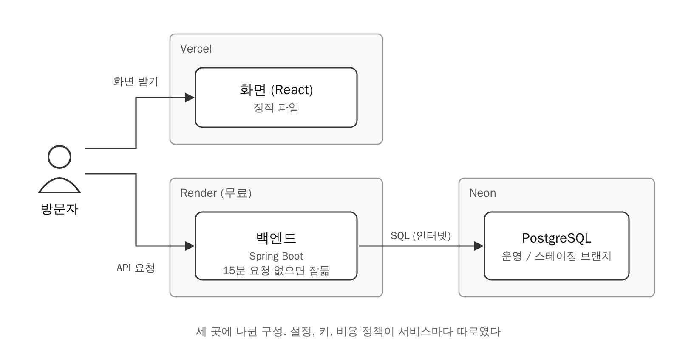
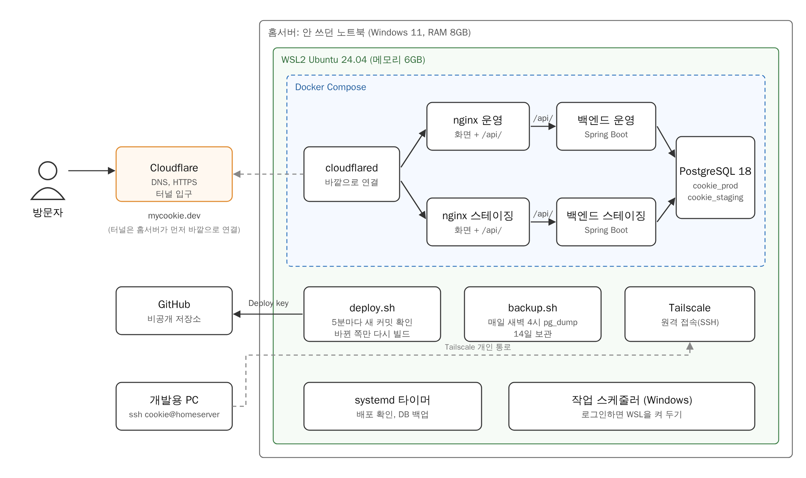
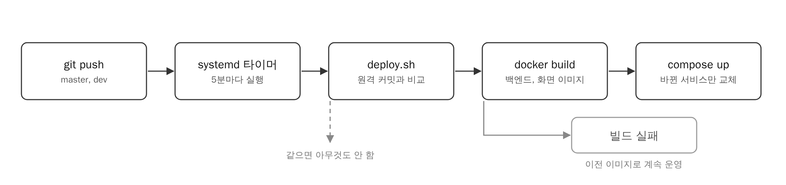
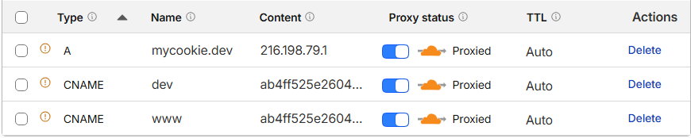
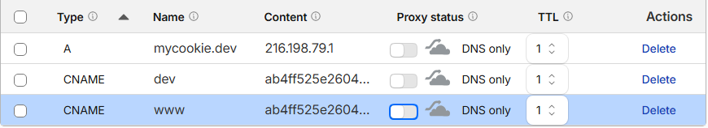
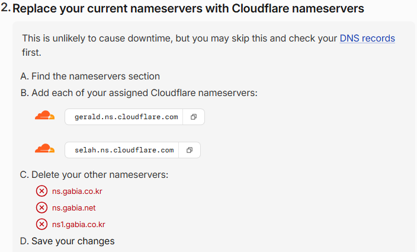
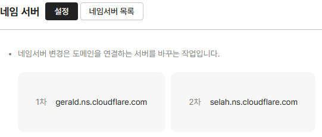
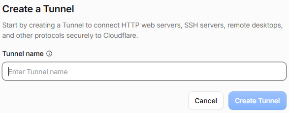

# 안 쓰던 노트북으로 홈서버 만들기: 나의쿠키를 클라우드에서 집으로 옮긴 기록

나의쿠키는 개발자 취업 준비생을 위한 학습 사이트입니다. 컴퓨터공학 전공 지식, 기술면접, 기업별 전공필기, 실시간 CS 대결 같은 기능을 혼자 만들고 운영하고 있습니다.

지금까지 나의쿠키는 무료 클라우드 세 곳에 나뉘어 있었습니다. 화면은 Vercel, 백엔드는 Render, DB는 Neon이었습니다. 처음에는 편했지만 서비스가 커질수록 불편한 점이 쌓였습니다. 이 글은 집에서 쓰지 않던 노트북을 홈서버로 만들고, 화면, 백엔드, DB를 모두 옮긴 과정을 정리한 기록입니다. 설계하면서 정한 원칙, 실제로 부딪힌 문제와 해결 방법을 순서대로 적었습니다.

## 왜 옮기기로 했나



*그림 1. 기존 구조. 화면, 백엔드, DB가 서로 다른 서비스에 있었다*

기존 구조에는 세 가지 문제가 있었습니다.

첫째, **백엔드가 잠들었습니다.** Render 무료 요금제는 15분 동안 요청이 없으면 서버를 재웁니다. 다음 방문자는 서버가 깨어날 때까지 30초 넘게 기다려야 했습니다. 이를 막으려고 GitHub Actions로 주기적으로 서버를 깨우고 있었지만, 무료 사용 시간(월 750시간)을 계속 신경 써야 했습니다.

둘째, **설정이 세 곳에 흩어져 있었습니다.** 환경 변수, 비밀 키, 도메인, 보안 헤더를 서비스마다 따로 관리했습니다. 무언가 바꾸려면 대시보드 세 개를 오가야 했고, 어디에 무엇을 넣었는지 기억에 의존했습니다.

셋째, **직접 운영해 보고 싶었습니다.** 클라우드가 대신해 주던 일(배포, 백업, 외부 노출, 장애 대응)을 직접 해 보면서 서버가 실제로 어떻게 돌아가는지 이해하고 싶었습니다.

## 설계 원칙

옮기기 전에 원칙부터 정했습니다. 이후의 모든 선택은 이 원칙을 기준으로 했습니다.

| 원칙 | 내용 |
| --- | --- |
| 한 대에서 전부 | 화면, 백엔드, DB를 노트북 한 대에서 Docker Compose로 돌린다 |
| 메모리 예산 8GB | 모든 컨테이너에 메모리 한도를 걸고, 합계가 8GB 안에 들어오게 한다 |
| 포트를 열지 않는다 | 공유기 설정 없이, 바깥 요청은 터널로만 들어오게 한다 |
| 상태는 PostgreSQL에 | 재시작해도 사라지면 안 되는 정보는 모두 DB에 둔다 |
| 표준 기술만 쓴다 | 특정 클라우드 전용 서비스 대신 PostgreSQL, SMTP처럼 직접 띄울 수 있는 것만 쓴다 |
| 설정은 환경 변수로 | 주소, 키, 메일 서버는 모두 `.env` 하나에 모은다 |

## 새 구조



*그림 2. 새 구조. 모든 구성 요소가 홈서버 한 대 안에 있다*

방문자가 `mycookie.dev`에 접속하면 Cloudflare가 요청을 받고, 홈서버가 미리 열어 둔 터널로 넘겨줍니다. 홈서버 안에서는 nginx가 화면 파일을 내보내고, `/api/`로 시작하는 요청은 같은 주소 그대로 백엔드에 넘깁니다. 운영과 스테이징은 nginx, 백엔드, DB 계정까지 따로 둬서 서로의 데이터를 볼 수 없게 했습니다.

컨테이너별 메모리 한도는 다음과 같습니다.

| 컨테이너 | 역할 | 메모리 한도 |
| --- | --- | --- |
| backend-prod | 운영 백엔드 (Spring Boot) | 1GB |
| backend-staging | 스테이징 백엔드 | 768MB |
| postgres | PostgreSQL 18 (운영, 스테이징 DB) | 768MB |
| frontend-prod, frontend-staging | nginx (화면 + API 전달) | 각 64MB |
| cloudflared | Cloudflare 터널 | 약 50MB |

합계는 약 2.7GB입니다. JVM은 컨테이너 한도의 75%까지만 힙을 쓰도록 `-XX:MaxRAMPercentage=75`를 줬습니다.

## 1. OS 고르기: Ubuntu Server와 Windows + WSL2

처음에는 Ubuntu Server를 설치하려고 했습니다. 서버 전용 OS라 가볍고, 24시간 운영에 안정적이기 때문입니다.

| | Ubuntu Server 설치 | Windows 그대로 + WSL2 |
| --- | --- | --- |
| 기존 데이터 | 전부 지워짐 | 그대로 |
| 준비물 | 설치용 USB | 없음 |
| OS가 쓰는 메모리 | 1GB 미만 | 3~4GB |
| 24시간 운영 | 안정적 | 업데이트 재부팅, 절전 관리 필요 |

하지만 가진 USB가 빌린 것 하나뿐이었고, 설치 USB를 만들면 통째로 포맷됩니다. 노트북 안의 자료도 아직 정리되지 않은 상태였습니다. 그래서 **Windows는 그대로 두고 WSL2(Windows 안에서 도는 리눅스)로 먼저 시작**하기로 했습니다. 나중에 서버 전용으로 굳히더라도 DB 덤프만 옮기면 되기 때문에 되돌리기 쉬운 선택이었습니다.

WSL2는 기본으로 노트북 메모리의 절반만 씁니다. 8GB 노트북이면 약 4GB라 부족했습니다. 사용자 폴더에 `.wslconfig`를 만들어 6GB로 늘렸습니다.

```ini
[wsl2]
memory=6GB
swap=4GB
```

## 2. 화면과 API를 같은 주소로

기존에는 화면(Vercel)과 백엔드(Render)의 주소가 달라서 CORS 설정이 필요했습니다. 새 구조에서는 nginx가 화면 파일과 API를 같은 주소에서 내보내므로 CORS가 필요 없습니다. 프런트엔드는 빌드할 때 API 주소를 상대 경로(`/api/v1`)로 받도록 바꿨습니다.

```nginx
location /api/ {
    proxy_pass $backend;
    proxy_set_header X-Forwarded-For $http_x_forwarded_for;
    proxy_buffering off;        # 실시간 채팅(SSE)이 끊기지 않게
    proxy_read_timeout 3600s;
}

location / {
    try_files $uri $uri.html $uri/ /index.html;
}
```

여기서 놓치기 쉬운 부분이 하나 있었습니다. 백엔드는 로그인 시도 같은 요청을 **접속한 사람의 IP별로** 제한합니다. 이 IP는 `X-Forwarded-For` 헤더의 마지막 값에서 읽습니다. nginx의 흔한 설정인 `$proxy_add_x_forwarded_for`를 쓰면 nginx가 헤더 끝에 자기 앞단(cloudflared 컨테이너)의 IP를 덧붙입니다. 그러면 백엔드는 **모든 방문자를 같은 사람으로** 보게 되고, 한 사람이 요청을 많이 보내면 다른 사람까지 함께 막힙니다. 그래서 nginx는 헤더를 덧붙이지 않고 받은 그대로 넘기게 했습니다. 마지막 값은 Cloudflare가 붙인 실제 접속 IP로 남습니다.

보안 헤더(CSP, HSTS 등)는 원래 `vercel.json`에 있었습니다. 같은 내용을 nginx에 손으로 옮기면 언젠가 어긋나기 때문에, `vercel.json`에서 nginx 설정을 자동으로 만드는 스크립트를 두고 둘이 같은지 검사하게 했습니다.

## 3. 배포 자동화



*그림 3. 배포 흐름. 5분마다 새 커밋을 확인하고, 바뀐 쪽만 다시 빌드한다*

GitHub Actions에서 홈서버로 바로 배포하려면 노트북을 바깥에 열어야 합니다. 원칙에 어긋나기 때문에 방향을 반대로 잡았습니다. **홈서버가 5분마다 GitHub에 새 커밋이 있는지 확인**하고, 있으면 그쪽만 다시 빌드합니다.

```bash
current=$(git -C "$ROOT/$dir" rev-parse HEAD)
target=$(git -C "$ROOT/$dir" rev-parse "origin/$branch")
if [ "$current" = "$target" ]; then return; fi

docker build -t "devcookie-backend:$tag" "$ROOT/$dir/backend"
docker build -t "devcookie-frontend:$tag" "$ROOT/$dir/frontend"
docker compose up -d --no-deps "backend-$tag" "frontend-$tag"
```

스크립트는 `set -e`로 시작합니다. 빌드가 하나라도 실패하면 그 자리에서 멈추고, 돌던 컨테이너는 이전 이미지로 계속 서비스합니다. 깨진 코드가 운영에 올라가는 일을 구조적으로 막은 셈입니다.

저장소가 비공개라서 홈서버 전용 **읽기 전용 Deploy key**를 만들어 GitHub에 등록했습니다. 홈서버는 코드를 받기만 하고, 저장소에 쓸 수는 없습니다.

작업 중에는 휴대폰 핫스팟으로 인터넷을 쓰고 있어서 데이터 사용량도 신경 썼습니다. 첫 배포에는 기본 이미지와 라이브러리를 받느라 2GB 가까이 들었습니다. 이후 배포까지 매번 라이브러리를 다시 받지 않도록 Dockerfile에서 라이브러리를 소스보다 먼저 받게 바꿨습니다. `build.gradle.kts`가 그대로면 Docker가 그 층을 재사용합니다.

```dockerfile
COPY build.gradle.kts settings.gradle.kts gradle.properties ./
RUN ./gradlew dependencies --no-daemon > /dev/null
COPY src src
RUN ./gradlew bootJar --no-daemon
```

## 4. DB 옮기기: Neon에서 홈서버로

### 운영과 스테이징 분리

PostgreSQL 한 대 안에 `cookie_prod`, `cookie_staging` 두 DB를 만들고, 접속 계정도 따로 만들었습니다. 스테이징 계정으로 운영 DB에 접속하면 거부됩니다.

```sql
CREATE ROLE cookie_prod LOGIN PASSWORD '...';
CREATE DATABASE cookie_prod OWNER cookie_prod;
REVOKE ALL ON DATABASE cookie_prod FROM PUBLIC;
```

### 백업

노트북 디스크가 고장 나면 DB도 함께 사라집니다. 매일 새벽 4시에 `pg_dump`로 두 DB를 덤프해서 14일치를 보관하고, 외장 디스크 경로를 지정하면 같은 파일을 복사하게 했습니다. 백업은 되살려 봐야 의미가 있기 때문에, 백업하고 데이터를 지운 뒤 되살리는 과정까지 시험했습니다.

### 이관과 버전 문제

Neon의 데이터를 `pg_dump`로 받아 홈서버에 `pg_restore`하는 스크립트를 만들었습니다. 그런데 처음 실행하자마자 멈췄습니다.

```
pg_dump: error: aborting because of server version mismatch
pg_dump: detail: server version: 18.7; pg_dump version: 17.12
```

Neon은 PostgreSQL 18인데 홈서버는 17로 띄웠던 것입니다. `pg_dump`는 자기보다 새 버전의 서버를 덤프하지 못합니다. 홈서버도 18로 올려 해결했습니다. 이때 PostgreSQL 18 공식 Docker 이미지는 데이터 폴더 위치가 바뀌었다는 점을 알게 됐습니다. 17까지처럼 `/var/lib/postgresql/data`에 볼륨을 붙이지 않고, 상위 폴더 `/var/lib/postgresql`에 붙여야 합니다.

연결 주소도 하나 바꿔야 했습니다. Neon이 기본으로 주는 주소는 연결을 중계하는 pooler 주소(`-pooler`)입니다. 덤프처럼 긴 작업에는 맞지 않아 `-pooler`를 뺀 직접 연결 주소를 썼습니다.

먼저 운영 데이터를 **읽기만 해서** 홈서버의 스테이징 DB에 넣고, 실제 계정으로 로그인해 학습 기록이 그대로 보이는지 확인했습니다. 실제 이관은 "마지막 복사"와 "주소 전환"을 연달아 해야 합니다. 복사만 먼저 해 두면 그 사이에 기존 서비스에 쌓인 기록이 사라지기 때문입니다.

## 5. 바깥에서 들어오는 길: Cloudflare Tunnel

홈서버는 집 안에 있어서 바깥에서 직접 찾아올 수 없습니다. 특히 휴대폰 핫스팟은 통신사가 공인 IP를 여러 사용자에게 나눠 쓰게 하는 방식(CGNAT)이라 포트를 열 수도 없습니다.

| 방법 | 핫스팟에서 | 내 도메인 | 비고 |
| --- | --- | --- | --- |
| 공유기 포트 개방 + 인증서 | 불가 | 가능 | 고정 IP, 인증서 갱신 필요. 노트북이 인터넷에 직접 노출 |
| Tailscale Funnel | 가능 | 불가 | 설정은 쉬움 |
| Cloudflare Tunnel | 가능 | 가능 | 무료, HTTPS 자동, 공격 방어 포함 |

Cloudflare Tunnel은 **홈서버가 먼저 Cloudflare로 연결을 걸어 두는 방식**입니다. 바깥에서 들어오는 요청은 그 연결을 거꾸로 타고 들어오기 때문에 노트북의 포트를 하나도 열지 않아도 됩니다.

### 도메인을 Cloudflare로 옮기기

도메인(`mycookie.dev`)은 가비아에서 샀습니다. Cloudflare에 도메인을 추가하면 기존 DNS 기록을 자동으로 읽어 옵니다.



*화면 1. 자동으로 읽어 온 DNS 기록. 기본값은 Proxied(주황 구름)다*

기본값은 모든 기록이 Cloudflare를 거치는 Proxied였습니다. 이 상태로 두면 아직 사이트를 서비스 중인 Vercel과 Cloudflare가 서로 HTTPS를 처리하려다 리디렉션이 반복될 수 있습니다. 이사하기 전까지는 기존 사이트가 그대로 돌도록 모두 DNS only로 바꿨습니다.



*화면 2. 이사 전까지는 DNS only(회색 구름)로 둔다*

그다음 가비아에서 네임서버를 Cloudflare가 알려 준 두 개로 바꿨습니다. 가비아 네임서버가 하나라도 남아 있으면 일부 사용자는 계속 옛 설정을 보게 되므로 전부 지웠습니다.



*화면 3. Cloudflare가 알려 준 네임서버와 지워야 할 가비아 네임서버*



*화면 4. 가비아 도메인 관리에서 네임서버를 Cloudflare 두 개로 변경*

반영까지 최대 24시간이 걸린다고 안내됐지만 실제로는 몇 분 만에 활성화 메일이 왔습니다.

### 터널 만들기



*화면 5. Cloudflare에서 터널을 만들고 토큰을 받는다*

터널을 만들면 토큰이 나옵니다. 이 토큰을 홈서버의 `.env`에 넣으면 compose가 cloudflared 컨테이너를 띄워 터널을 엽니다. 토큰이 없을 때도 나머지 서비스는 뜨도록 해서, 터널을 연결하기 전에 홈서버 안(`localhost:8080`)에서 먼저 확인할 수 있게 했습니다.

## 6. 개발용 PC에서 원격으로 관리하기

서버를 관리할 때마다 노트북 앞에 앉을 수는 없습니다. 내 기기끼리만 연결되는 개인 통로를 만들어 주는 Tailscale을 WSL 안에 설치하고, 개발용 PC에서 `ssh cookie@homeserver`로 접속하게 했습니다.

처음에는 연결이 되지 않았습니다. 홈서버가 계속 offline으로 보였고, 로그에는 이런 경고가 있었습니다.

```
Tailscale hasn't received a network map from the coordination server
iptables ... Extension connmark revision 0 not supported, missing kernel module?
```

WSL2의 커널이 Tailscale이 쓰는 iptables 기능 일부를 지원하지 않아서였습니다. 커널 네트워크 기능 대신 Tailscale이 직접 패킷을 처리하는 사용자 공간 모드로 바꿔 해결했습니다.

```bash
sudo sed -i 's/^FLAGS=.*/FLAGS="--tun=userspace-networking"/' /etc/default/tailscaled
sudo systemctl restart tailscaled
sudo tailscale up --ssh --hostname=homeserver --netfilter-mode=off
```

## 7. 겪은 문제 정리

| 문제 | 원인 | 해결 |
| --- | --- | --- |
| `docker` 그룹이 없음 | 공식 설치 스크립트가 WSL을 감지하고 멈춤 | Ubuntu 패키지(`docker.io`)로 설치 |
| `stat .: permission denied` | 다른 계정의 집 폴더에서 `sudo -u`로 실행 | 스크립트 시작 시 작업 폴더로 이동 |
| 작업 스케줄러 "작업을 만들 수 없습니다" | PIN으로만 로그인하는 계정이라 비밀번호 저장 불가 | "로그온할 때 실행"으로 바꾸고 자동 로그인 사용 |
| `pg_dump` 버전 불일치 | Neon 18, 홈서버 17 | 홈서버를 PostgreSQL 18로, 볼륨 위치 변경 |
| 덤프 중 연결 문제 우려 | pooler 주소 | `-pooler`를 뺀 직접 연결 주소 사용 |
| Tailscale offline | WSL 커널이 iptables 기능 일부 미지원 | 사용자 공간 네트워킹 |
| 결제 화면이 막힐 뻔함 | 보안 헤더를 nginx에 손으로 옮겨 토스 결제 주소 누락 | `vercel.json`에서 nginx 헤더 자동 생성 |

작업 중에 한 가지 실수도 있었습니다. DB 연결 주소를 확인하다가 비밀번호가 든 주소를 그대로 메신저에 붙여 넣었습니다. 이관이 끝나면 비밀번호를 재설정하기로 했고, 이후로는 비밀 값은 서버의 `.env`에 직접 넣고 확인이 필요하면 값 대신 개수만 보도록 습관을 바꿨습니다.

```bash
sudo grep -c "^TUNNEL_TOKEN=eyJ" /srv/devcookie/.env   # 값은 보지 않고 1인지만 확인
```

## 마치며

지금은 홈서버에서 운영과 스테이징 서버가 함께 돌고 있고, 실제 회원 데이터를 옮겨 로그인까지 확인했습니다. Cloudflare 터널도 연결해서 바깥에서 들어오는 길을 열었습니다. 남은 일은 집 인터넷(유선)으로 바꾼 뒤 운영 데이터를 마지막으로 옮기고 `mycookie.dev`를 홈서버로 전환하는 것입니다.

직접 해 보니 클라우드가 대신해 주던 일이 생각보다 많았습니다. 배포, 백업, 외부 노출, 원격 관리, 재부팅 뒤 자동 시작까지 하나하나가 따로 고민해야 하는 문제였습니다. 반대로 그 일들을 직접 정하니 구조 전체가 한눈에 들어왔습니다. 무엇이 어디서 돌고, 무엇이 실패하면 어떻게 되는지 설명할 수 있게 된 것이 가장 큰 수확이었습니다.

노트북 한 대는 정전이나 고장에 약합니다. 그래서 백업을 외장 디스크에 두고, 한 달에 한 번은 스테이징에 되살려 보며 정말 쓸 수 있는 백업인지 확인할 계획입니다.
