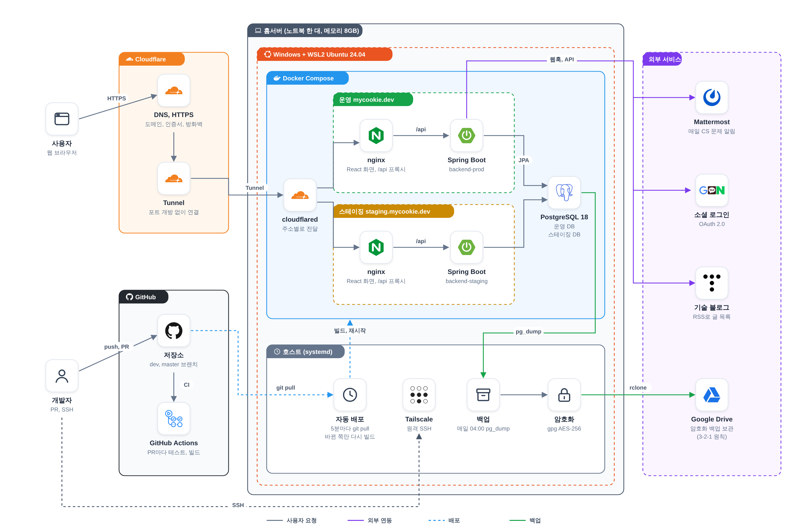

# 나의쿠키 개발기: 취업 준비를 한 곳에서 하고 싶어서

> 태그: 나의쿠키, 사이드프로젝트, 회고
> 【직접 채우기】 표시가 있는 곳은 본인 경험으로 한두 문장 바꿔 주세요.

나의쿠키(mycookie.dev)는 신입 개발자 취업 준비를 한 곳에서 할 수 있게 만든 학습 사이트입니다. CS 전공지식, 기술면접, 기업별 전공필기, 실시간 CS 대결, 학습 기록을 한 사이트에서 다룹니다. 기획부터 화면, 서버, 운영까지 혼자 만들고 있습니다.

이 글은 기능 소개보다 **왜 만들었고, 만들면서 무엇을 고민했는지**를 정리한 기록입니다.

## 왜 만들었나

취업 준비를 하면서 공부할 곳이 너무 많았습니다. CS 개념은 블로그와 책에서, 면접 질문은 깃허브 정리 저장소에서, 기업별 전공필기는 카페와 기출 후기에서, 코딩테스트는 또 다른 사이트에서 따로 봤습니다.

【직접 채우기: 예) 전공필기 시험을 준비하면서 기출 자료를 찾느라 공부보다 검색에 시간을 더 썼던 경험】

흩어져 있는 것보다 더 큰 문제는 **기록이 남지 않는다**는 점이었습니다. 어제 틀린 문제가 무엇이었는지, 어느 과목이 약한지, 이번 주에 얼마나 공부했는지 알 수 없었습니다. 혼자 공부하다 보니 꾸준히 이어 가기도 어려웠습니다.

그래서 세 가지를 목표로 정했습니다.

| 문제 | 해결 |
| --- | --- |
| 자료가 흩어져 있다 | 전공노트, 면접 질문, 기업별 문제를 한 사이트에 모은다 |
| 기록이 남지 않는다 | 오답노트, 북마크, 풀이 수, 약한 주제를 자동으로 쌓는다 |
| 혼자라 지친다 | 같은 문제를 동시에 푸는 대결, 티어와 승급 시험으로 재미를 준다 |

## 어떻게 커졌나

처음부터 지금 모습을 그린 것은 아닙니다. 필요한 것을 하나씩 붙이다 보니 지금의 서비스가 됐습니다.

**9월, 전공필기 문제은행.** 시작은 제가 볼 시험을 위한 문제집이었습니다. 기업별 예상문제집과 모의고사, 오답노트, 북마크를 만들었습니다. 이때 DB를 Neon PostgreSQL로 옮기고, 이용 현황을 보는 운영 화면도 만들었습니다.

**10월, 대결과 기술면접.** 혼자 문제만 풀면 금방 지쳐서, 같은 10문제를 풀고 점수를 겨루는 1:1 대결과 단체전을 만들었습니다. 풀이 수에 따라 오르는 티어와 승급 시험, 매일 바뀌는 오늘의 CS도 이때 붙였습니다. 여러 기기에서 기록이 이어지도록 계정 동기화도 만들었습니다.

**11월, 리뉴얼과 정식 오픈.** 시험 문제집에서 **개발자 취업 준비 사이트**로 방향을 넓혔습니다. 메뉴를 컴퓨터공학, 웹 개발, 면접, 실전, 내 학습으로 다시 나누고, 이름을 나의쿠키로 바꿔 mycookie.dev로 정식 오픈했습니다. 소셜 로그인, 이메일로 비밀번호 재설정, 매일 아침 CS 메일도 이때 추가했습니다.

## 만들면서 고민한 것

### 1. 대결 점수는 서버가 채점한다

처음에는 화면에서 채점한 점수를 서버에 보냈습니다. 그런데 이러면 요청만 조작해도 점수를 바꿀 수 있습니다. 순위와 티어가 걸린 기능이라 그대로 둘 수 없었습니다. 그래서 정답표를 서버에 두고 **서버가 직접 채점**하도록 바꿨습니다.

여러 명이 동시에 "한 판 더"를 누르면 방이 여러 개로 갈라지는 문제도 있었습니다. 동시에 들어온 요청이 같은 방으로 모이도록 처리했고, 이 과정은 [대결 동시성 문서](https://github.com/AnChanUng/mycookie/blob/master/docs/duel-concurrency.md)에 따로 정리했습니다.

### 2. 보안은 "혼자 만든 서비스니까"로 넘기지 않는다

처음 비밀번호 재설정은 닉네임만 알면 누구나 할 수 있었습니다. 남의 계정을 가져갈 수 있는 구조라, **이메일 인증을 거쳐야만 재설정**되도록 고쳤습니다. 로그인과 인증 요청에는 IP별 요청 제한을 걸고, 보안 헤더와 크롤링 대응도 정리했습니다.

### 3. 클라우드 세 곳에서 홈서버 한 대로

화면은 Vercel, 백엔드는 Render, DB는 Neon에 있었습니다. 무료 백엔드가 15분마다 잠들어 첫 방문자가 30초를 기다려야 했고, 설정이 세 곳에 흩어져 있었습니다. 그래서 쓰지 않던 노트북을 **홈서버**로 만들어 모두 옮겼습니다.

*나의쿠키 인프라 구조도. 화면, 백엔드, DB를 홈서버 한 대에서 Docker Compose로 돌린다*

공유기 포트를 열지 않고 Cloudflare Tunnel로 외부 요청을 받고, 5분마다 바뀐 코드만 다시 빌드하는 자동 배포와 매일 새벽 암호화 백업(3-2-1 원칙)을 직접 만들었습니다. 자세한 과정은 [홈서버 구축하기: 서버 구축부터 DB 마이그레이션까지](https://cookie.tistory.com/258)에 적었습니다.

### 4. 고장 난 코드가 배포되지 않게

홈서버로 옮긴 뒤 한 번은 백엔드가 아예 켜지지 않아 사이트 전체가 멈췄습니다. 생성자가 두 개인 클래스에 스프링이 쓸 생성자를 지정하지 않아서, 앱이 시작하자마자 죽고 재시작을 반복했습니다. 로컬에서 그 클래스 테스트만 돌리고 전체 테스트를 돌리지 않은 것이 원인이었습니다.

그래서 **GitHub Actions로 CI**를 붙였습니다. PR마다 백엔드 전체 테스트, 화면 린트와 빌드, 문제 데이터 검사를 자동으로 돌립니다. CI를 붙이자마자 새로 추가한 문제 27개가 대결 정답표에 빠져 있던 버그도 찾았습니다.

## 혼자 개발하는 방식

혼자 만들지만 팀처럼 일하려고 했습니다.

- **이슈부터:** 작업마다 GitHub 이슈를 한글로 등록하고, 기능과 버그 템플릿을 씁니다.
- **브랜치와 PR:** `feature/*`, `fix/*`에서 작업하고 `dev`(스테이징)에서 확인한 뒤 `master`(운영)로 올립니다.
- **버전 기록:** `vX.Y.Z` 태그와 GitHub Release, 사용자용 패치노트를 따로 남깁니다.
- **AI와 함께:** 코드 작성과 리뷰에 AI를 적극적으로 쓰되, 배포 전 확인과 비밀값 관리는 직접 합니다.

## 앞으로

- 사용자가 남긴 버그 제보와 기능 요청이 Mattermost로 바로 오고, 버튼 하나로 GitHub 이슈가 되게 만들 예정입니다.
- 학습 자료에 근거해서만 답하는 AI 학습 도우미(RAG)를 정식으로 열 예정입니다.
- 홈서버가 꺼졌을 때를 대비한 장애 알림과 이중화를 준비하고 있습니다.

【직접 채우기: 마무리 한두 문장. 예) 처음엔 제 시험 공부용이었지만, 이제는 같은 길을 가는 사람들이 함께 쓰는 서비스가 되면 좋겠습니다.】

나의쿠키는 [mycookie.dev](https://mycookie.dev)에서 써 볼 수 있습니다.
