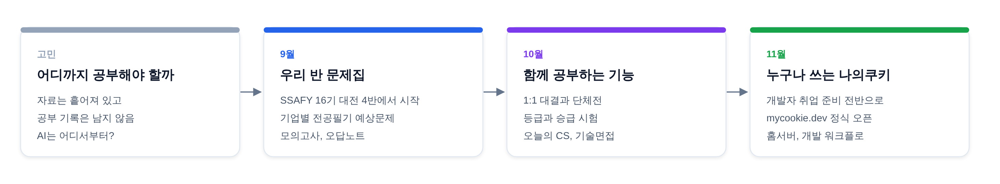
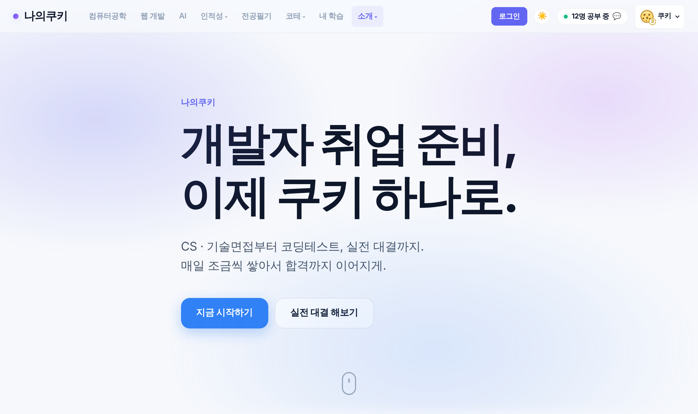

# 나의쿠키를 만든 이유: 어디까지 공부해야 할지 고민하던 취업 준비생의 기록

> 태그: 나의쿠키, 사이드프로젝트, SSAFY, 개발자취업, 회고

나의쿠키(mycookie.dev)는 개발자 취업 준비를 위한 학습 사이트입니다. 컴퓨터공학 기초, 기술면접, 기업별 전공필기, 실시간 CS 대결, 학습 기록을 한곳에서 다룹니다.

처음부터 많은 사람이 쓰는 서비스를 만들려던 것은 아니었습니다. 취업을 준비하면서 스스로 답을 찾지 못한 고민이 있었고, 그 고민을 풀려고 만든 문제집이 반 친구들과 함께 쓰는 사이트가 됐고, 지금은 누구나 쓸 수 있는 서비스가 됐습니다. 이 글은 그 과정을 있는 그대로 정리한 기록입니다.

## 1. 어디까지 공부해야 할까

개발자로 취업을 준비하면서 가장 많이 한 고민은 "어디까지 깊게 알아야 할까"였습니다.

자료구조와 운영체제를 다시 봐야 할지, 스프링을 더 깊게 파야 할지, 요즘 다들 한다는 AI는 어디서부터 시작해야 할지 매일 고민했습니다. 개발자 로드맵을 찾아볼수록 해야 할 것은 줄지 않고 늘어났습니다. 로드맵은 갈 수 있는 길을 모두 보여 줬지만, 지금 나에게 필요한 만큼이 어디까지인지는 알려 주지 않았습니다.

공부할 곳도 흩어져 있었습니다. CS 개념은 블로그와 책에서, 면접 질문은 정리 저장소에서, 기업별 전공필기는 후기에서, 코딩테스트는 또 다른 사이트에서 따로 봤습니다. 그러다 보니 어제 틀린 문제가 무엇이었는지, 어느 과목이 약한지, 이번 주에 얼마나 공부했는지가 어디에도 남지 않았습니다.

【직접 채우기: 이 고민이 가장 크게 느껴졌던 순간 한두 문장. 예) 전공필기 시험을 앞두고 기출 자료를 찾느라 공부보다 검색에 시간을 더 썼을 때】

## 2. 내린 결론: 넓게 이해하고, 하나는 깊게

고민 끝에 내린 결론은 단순했습니다.

예전에는 백엔드나 프론트엔드 하나만 잘 알아도 괜찮았습니다. 지금은 조금 다릅니다. 당장 쓰지 않더라도 AI, 인프라, 백엔드를 고루 이해하고, 그중 한 분야는 깊게 아는 사람이 필요하다고 생각했습니다.

돌아보면 이 흐름은 예전에도 변한 적이 없었습니다. 기술의 이름만 바뀌었을 뿐, 넓게 이해하고 하나를 깊게 판 사람이 언제나 좋은 개발자였습니다. AI도 마찬가지라고 봤습니다. AI는 이제 피할 수 없는 분야지만, AI만 공부하는 것이 답은 아닙니다. AI가 어떻게 동작하는지 이해하고, 그 위에서 돌아가는 서비스의 기본기를 갖추는 것이 먼저라고 생각했습니다.

그래서 기준을 세 가지로 정했습니다.

| 기준 | 의미 |
| --- | --- |
| 넓게 이해하기 | 컴퓨터공학, 웹 개발, AI, 인프라를 고루 훑는다 |
| 하나는 깊게 | 고른 분야는 면접에서 막히지 않을 만큼 판다 |
| 매일 조금씩 | 하루 한 문제라도 꾸준히 쌓고, 기록으로 남긴다 |

이 기준대로 공부할 수 있는 곳이 없어서, 직접 만들기로 했습니다.

## 3. 시작은 우리 반 문제집이었다

*그림 1. 우리 반 문제집에서 누구나 쓰는 서비스까지*

첫 버전은 제가 준비하던 기업별 전공필기를 위한 문제집이었습니다. 기업별 예상문제집과 모의고사, 틀린 문제를 모아 보는 오답노트를 만들었습니다. 이 문제집을 같은 반인 SSAFY 16기 대전 4반에서 먼저 함께 썼습니다.

【직접 채우기: 반에서 처음 썼을 때의 반응 한두 문장. 예) 몇 명이 매일 풀었는지, 어떤 말을 들었는지】

반 친구들이 쓰기 시작하면서 필요한 기능이 하나씩 보였습니다. 혼자 문제만 풀면 금방 지친다는 이야기가 많아서, 같은 10문제를 동시에 풀고 점수를 겨루는 1:1 대결과 단체전을 만들었습니다. 꾸준히 이어 갈 이유가 필요해서 풀이 수에 따라 오르는 등급과 승급 시험, 매일 바뀌는 오늘의 CS를 붙였습니다. 기술면접 질문과 꼬리질문, 실시간 채팅도 이때 들어왔습니다.

이 시기의 사용자들에게는 지금도 "SSAFY 16기 대전 4반" 배지가 붙어 있습니다. 처음부터 함께 써 준 사람들을 기억하고 싶어서 남겨 둔 기록입니다.

## 4. 우리 반에서 누구나로

【직접 채우기: 반 밖으로 넓히기로 한 계기 한두 문장. 예) 다른 반, 다른 캠퍼스에서 써 보고 싶다는 이야기를 들었을 때】

반 안에서 쓰이던 문제집을 누구나 쓸 수 있는 서비스로 넓히기로 했습니다. 다만 그대로 열 수는 없었습니다. 처음 만든 문제집은 특정 시험 준비에 맞춰져 있었기 때문입니다.

그래서 방향을 "개발자 취업 준비 전반"으로 넓혔습니다. 처음에 세운 기준처럼 넓게 훑고 하나를 깊게 팔 수 있도록 메뉴를 컴퓨터공학, 웹 개발, AI, 인적성, 전공필기, 코딩테스트로 다시 나눴습니다. 이름도 나의쿠키로 바꾸고, mycookie.dev로 정식으로 열었습니다. 쿠키를 하나씩 모으듯 하루에 한 문제씩 쌓아 가자는 뜻입니다.

*그림 2. 지금의 나의쿠키 첫 화면*

누구나 쓰는 서비스가 되면서 운영도 달라져야 했습니다. 무료 클라우드 세 곳에 나뉘어 있던 서비스를 홈서버 한 대로 옮겼고, 버그 제보부터 장애 알림까지 이어지는 개발 워크플로를 새로 만들었습니다. 이 과정은 각각 따로 정리했습니다.

- [홈서버 구축하기: 서버 구축부터 DB 마이그레이션까지](https://cookie.tistory.com/258)
- 작은 서비스의 개발 워크플로 설계와 적용: 이슈부터 장애 알림까지

## 5. AI는 어떻게 공부하게 할까

처음 고민 중 하나였던 AI는 나의쿠키에서도 계속 고민하는 부분입니다. AI 메뉴에서는 머신러닝, 딥러닝, 자연어 처리의 기본 개념을 문제로 다룹니다. 도구를 쓰는 법보다 원리를 이해하는 데 초점을 뒀습니다.

지금은 학습 자료에 근거해서만 답하는 AI 학습 도우미를 준비하고 있습니다. 자료에 없는 질문에는 지어내지 않고 답하지 않도록 만드는 것이 목표입니다. 공부를 돕는 AI라면 그럴듯한 답보다 틀리지 않는 답이 더 중요하다고 생각했습니다.

## 6. 마치며

나의쿠키는 "어디까지 공부해야 할까"라는 질문에서 시작했습니다. 아직 그 질문에 대한 완벽한 답은 없습니다. 다만 넓게 이해하고, 하나는 깊게 파고, 매일 조금씩 쌓는다는 기준은 지금도 그대로입니다.

【직접 채우기: 마무리 한두 문장. 예) 처음엔 우리 반 문제집이었지만, 같은 고민을 하는 사람들이 함께 쓰는 서비스가 되면 좋겠다】

나의쿠키는 [mycookie.dev](https://mycookie.dev)에서 쓸 수 있습니다.
